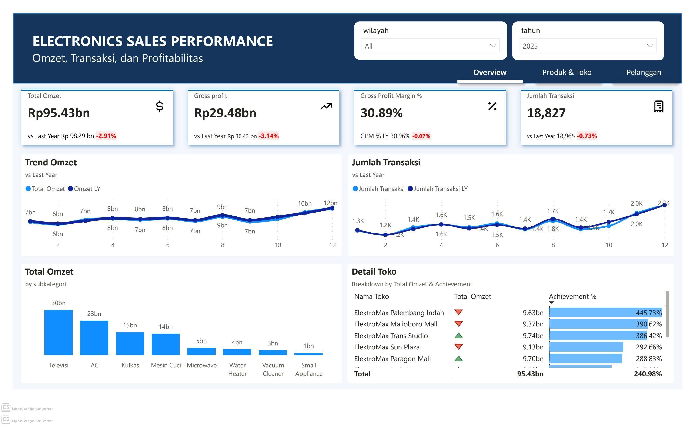
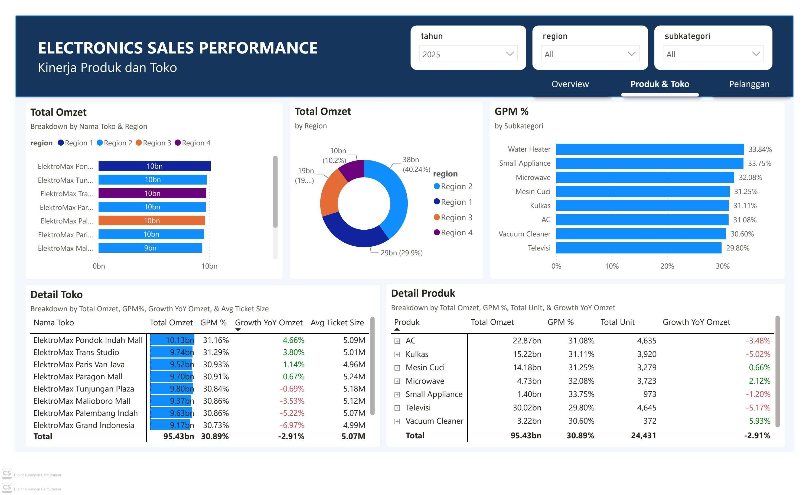
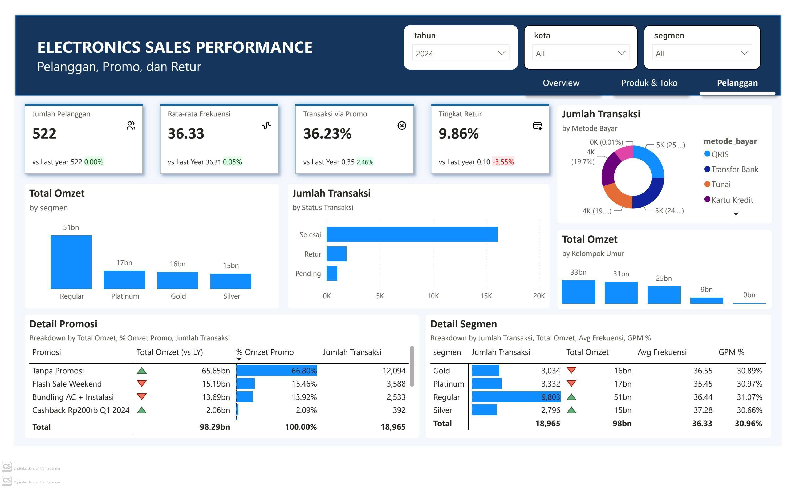

# Dashboard Performa Penjualan Elektronik | Power BI

Dashboard Power BI untuk memantau kinerja penjualan elektronik: omzet, profitabilitas, produk, toko, dan pelanggan.

## Pertanyaan bisnis
- Bagaimana tren omzet dan transaksi dibanding tahun lalu?
- Produk dan toko mana yang paling berkontribusi?
- Seperti apa pola pembelian pelanggan, pemakaian promo, dan retur?

## Tampilan dashboard

## Temuan utama
- Omzet bergantung pada segmen Regular, yang menyumbang sekitar separuh omzet dan transaksi.
- Sekitar 68% omzet datang dari transaksi tanpa promo; porsi transaksi via promo turun dibanding tahun lalu.
- Rata-rata frekuensi dan GPM antar segmen hampir sama, jadi segmentasi saat ini belum membedakan perilaku beli.
- Tingkat retur sekitar 9,95%, membaik tipis dari tahun lalu.

## Rekomendasi
- Uji promo musiman (Lebaran, Year End Sale, HUT RI) karena kontribusi omzetnya masih di bawah 1%

## Model data
Star schema: satu tabel fakta (`FACT_PENJUALAN`) dan dimensi pelanggan, produk, promosi, toko, dan waktu. Measure utama: Total Omzet, Omzet LY, GPM %, Growth YoY, Avg Frekuensi, % Retur, Achievement %.

## Tools
Power BI Desktop, DAX, data modeling

## Catatan data
Data simulasi untuk keperluan portofolio

## Cara membuka
Unduh file `electronics-sales-dashboard.pbix` lalu buka dengan Power BI Desktop.
